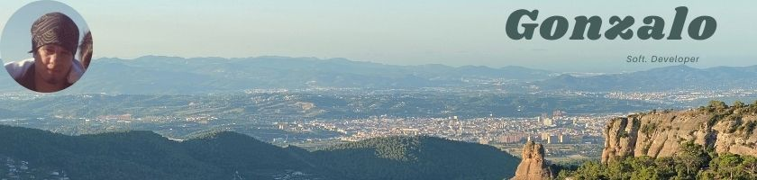

### Hi, I'm Gonzalo

Full-stack developer, 17+ years in production. Right now I work in TypeScript,
Next.js and NestJS on AWS, building e-commerce and payment systems.

Before that, seven years on Walt Disney Parks and Resorts Online through Globant,
from backend Java developer to tech lead.

I build with AI agents in the loop — Cursor and Claude Code are part of my normal
workflow, not a side experiment.

**Stack:** TypeScript · Node.js · NestJS · React · Next.js · AWS · PostgreSQL · Java / Spring Boot

📫 g0ng0n.dev@gmail.com · [LinkedIn](https://linkedin.com/in/gongis)
